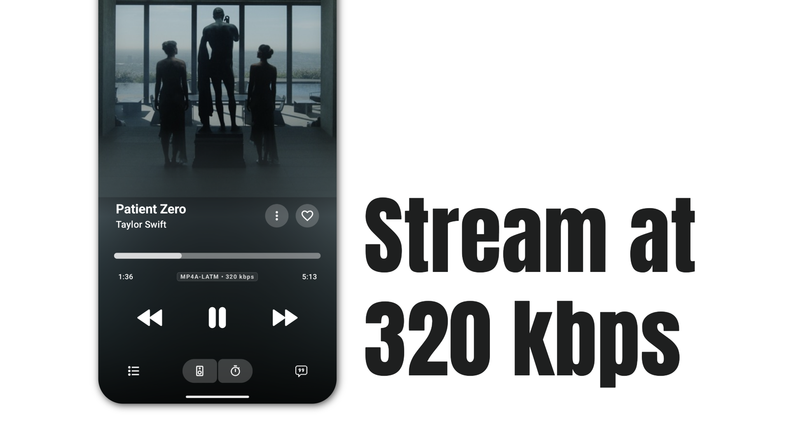

<p align="center">
  
</p>

Connect JioSaavn to Echo Music using your own Cloudflare Worker and enjoy audio at up to **320 kbps**, where available. No API key is required.

## 1. Deploy to Cloudflare

You will need a [Cloudflare account](https://dash.cloudflare.com/sign-up) and a [GitHub account](https://github.com/signup).

[](https://deploy.workers.cloudflare.com/?url=https://github.com/EchoMusicApp/saavn-extension)

1. Click **Deploy to Cloudflare Workers** above.
2. Sign in to Cloudflare and connect your GitHub account when prompted.
3. Follow the setup prompts to create a copy of this repository in your GitHub account and configure the Worker.
4. If asked for build and deployment commands, use:

   | Setting        | Command                              |
   | -------------- | ------------------------------------ |
   | Build command  | `npm run check && npm run test:echo` |
   | Deploy command | `npx wrangler deploy`                |

   Cloudflare installs dependencies automatically. No API keys, secrets, or bindings are needed.

5. Start the deployment and wait for it to complete successfully.

## 2. Copy Your Server URL

1. Open your deployed Worker in the Cloudflare dashboard under **Workers & Pages**.
2. Open its public `workers.dev` URL. It will look like:

   ```text
   https://saavn-extension.your-account.workers.dev
   ```

3. On the extension's landing page, click **Copy URL**.

Use your own deployment's base URL. Do not add `/docs`, `/search`, or a song link.

## 3. Add the Server in Echo Music

1. Open **Echo Music**.
2. Go to **Profile / Settings**, then **Extension**.
3. Select **Add Custom Server**.
4. In **Name**, enter any name you like, such as `Saavn`.
5. In **Server URL**, paste the URL copied from your Cloudflare deployment.
6. Save the server and enable it if prompted.

That's it. Search for a song and enjoy audio at up to **320 kbps**. Tracks without a 320 kbps stream use the best available quality.

## Credits and License

Based on [JioSaavn API by Sumit Kolhe](https://github.com/sumitkolhe/jiosaavn-api), adapted for Echo Music and Cloudflare Workers. This is an unofficial JioSaavn extension; Cloudflare usage limits apply.

Licensed under [MIT](LICENSE).
